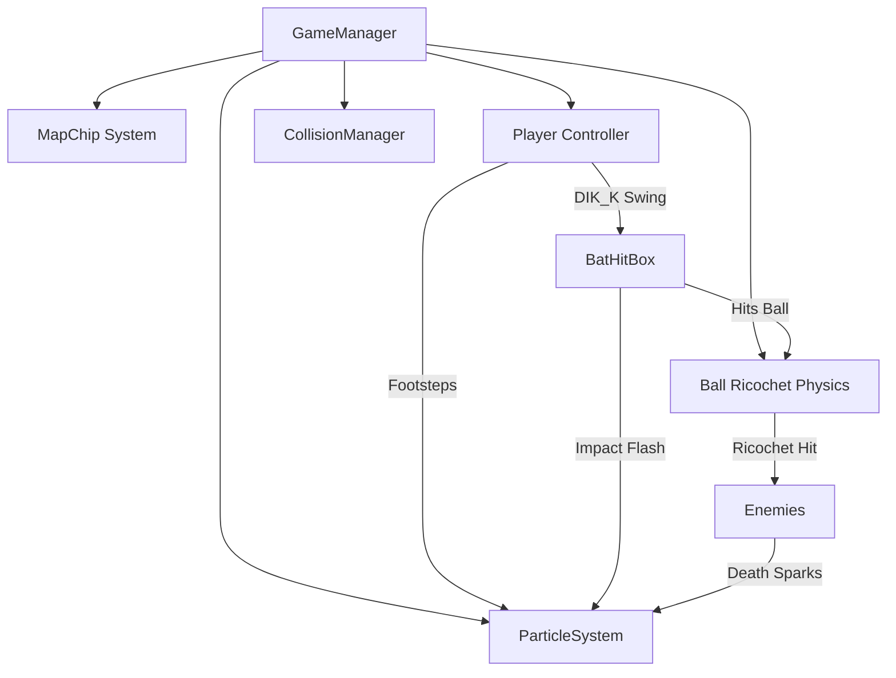

# Rizeallday Engine & Sandbox — Comprehensive Technical Handover Document

> **Tujuan Dokumen:**
> Dokumen ini dirangkum secara mendalam sebagai panduan lengkap (*context handover*) bagi AI assistant (seperti Claude) maupun software engineer untuk memahami seluruh arsitektur engine DirectX 12, konvensi matematika, pipeline model/animasi 3D FBX, serta sistem gameplay 2.5D platformer yang dibangun pada proyek ini.

---

## 1. Project Overview & Environment

* **Root Directory:** `D:\AL4\AL4_1`
* **Solusi Visual Studio:** Visual Studio 2022 Community (`v143` toolset, C++20, platform `x64`)
* **Konfigurasi Aktif:** `Development`
* **Target Binary Output:** `D:\AL4\AL4_1\RizealldaySandbox\x64\Development\RizealldaySandbox.exe`
* **Sub-Projects:**
  1. **`RizealldayEngine`** (Static Library / Engine Core)
     - `D:\AL4\AL4_1\RizealldayEngine`
     - Engine 3D berbasis DirectX 12 murni (tanpa wrapper engine pihak ketiga).
  2. **`RizealldaySandbox`** (Executable / Game Application)
     - `D:\AL4\AL4_1\RizealldaySandbox`
     - Game 2.5D Mega Man platformer bertema ricochet ball & baseball bat.
  3. **`DirectXTex`** (`externals/DirectXTex`)
     - Library manipulasi tekstur Microsoft untuk DirectX 12.
* **Command Build MSBuild:**
  ```powershell
  & "C:\Program Files\Microsoft Visual Studio\18\Community\MSBuild\Current\Bin\MSBuild.exe" "D:\AL4\AL4_1\RizealldaySandbox\RizealldaySandbox.vcxproj" /p:Configuration=Development /p:Platform=x64 /v:minimal
  ```

---

## 2. Engine Architecture & Mathematical Conventions

### 2.1. Coordinate System
* **Sistem Koordinat:** DirectX 12 Left-Handed System
  * $+X$ = Bergerak ke Kanan (Horizontal)
  * $+Y$ = Bergerak ke Atas (Vertikal / Tinggi)
  * $+Z$ = Bergerak Masuk ke Kedalaman Layar (Forward / Depth)
* **Bidang Permainan 2.5D:** Permainan dikunci pada bidang $Z = 0.0\text{f}$.
* **Kamera:**
  * Posisi default: $(x_{player}, y_{player} + 2.0, -12.0)$ mengarah ke $+Z$.
  * Pada stage tutorial: kamera melakukan *zoom out* ke $Z = -20.5\text{f}$ agar seluruh arena $16\text{m} \times 8\text{m}$ terlihat penuh.

### 2.2. Konvensi Vektor & Matriks
* **Representasi Vektor:** **Row-Vector** ($v = \begin{bmatrix} x & y & z & 1 \end{bmatrix}$).
* **Transformasi Vektor:** Dikalikan dari kiri ke kanan:
  $$v_{out} = v_{in} \cdot M$$
* **Perkalian Matriks (`MathUtil.cpp`):**
  Untuk matriks `Multiply(m1, m2)`, hasil perkalian mengalikan baris `m1` dengan kolom `m2`:
  $$M_{res} = M_1 \cdot M_2$$
* **Konstruksi Affine Matrix (`Mathematics::MakeAffineMatrix`):**
  $$M = S \cdot (R_x \cdot R_y \cdot R_z) \cdot T$$
  ```cpp
  Matrix4x4 rotateXYZMatrix = Multiply(rotateXMatrix, Multiply(rotateYMatrix, rotateZMatrix));
  Matrix4x4 result = Multiply(scaleMatrix, Multiply(rotateXYZMatrix, translateMatrix));
  ```
* **Kompilasi Shader (`DXCManager.cpp`):**
  * Menggunakan compiler DirectX Shader Compiler (DXC) HLSL Shader Model 6.0 (`vs_6_0`, `ps_6_0`).
  * Wajib menyertakan parameter flag `-Zpr` (**Pack matrices in row-major order**).
  * Di dalam file shader `Object3d.VS.hlsl`:
    ```hlsl
    skinnedPos = mul(float32_t4(input.position.xyz, 1.0f), skinMatrix);
    output.position = mul(skinnedPos, gTransformationMatrix.WVP);
    ```
    Operasi `mul(vector, Matrix)` pada format row-major mengevaluasi $v \cdot M$ secara matematis konsisten dengan CPU C++.

### 2.3. Pipeline & Blend Modes (`GraphicPipeline.cpp`)
Engine mendukung 4 blend mode melalui `BlendMode` enum:
1. `BlendMode::None` (Opaque)
2. `BlendMode::AlphaBlend` (`SrcBlend = SRC_ALPHA, DestBlend = INV_SRC_ALPHA`) — Digunakan untuk asap kaki player (`footstep smoke`).
3. `BlendMode::Add` (`SrcBlend = SRC_ALPHA, DestBlend = ONE`) — Digunakan untuk partikel bat hit (oranye) dan partikel ledakan musuh (merah menyala).
4. `BlendMode::Multiply`

---

## 3. Pipeline Model 3D & Skeletal Animation (`Model.cpp`, `Object3d.cpp`)

### 3.1. Struktur Model & Assimp Import
* Model dimuat menggunakan Assimp (`Assimp::Importer`).
* Flag import utama:
  ```cpp
  importer.SetPropertyBool(AI_CONFIG_IMPORT_FBX_PRESERVE_PIVOTS, false);
  importer.ReadFile(path, aiProcess_Triangulate | aiProcess_FlipUVs | aiProcess_GenSmoothNormals | aiProcess_JoinIdenticalVertices | aiProcess_LimitBoneWeights);
  ```
* **Bone Palette Constant Buffer:**
  Alokasi array matriks GPU untuk 128 tulang (`sizeof(Matrix4x4) * 128 = 8192 bytes`), di-bind pada register `b1` di HLSL.

### 3.2. Masalah Koordinat Blender vs DirectX (Penyebab Karakter Terlentang & Animasi Terbalik)
* **Fakta Ekspor Blender:**
  * Blender beroperasi pada sistem **Z-Up** (tinggi karakter ada pada sumbu $Z$).
  * Saat mengekspor ke FBX, Blender meletakkan rotasi kompensasi $-90^\circ$ pada sumbu $X$ pada node `Armature` dan node `Mesh` (`rot = (w: 0.707, x: -0.707, y: 0, z: 0)`).
* **Mengapa Karakter Tidur Terlentang?**
  * Pada DirectX 12, sumbu vertikal adalah $+Y$.
  * Jika vertex mesh atau tulang dievaluasi tanpa rotasi Pitch $X = -90^\circ$, tinggi model ($Z \in [0.52, 4.04]$) akan membentang di sepanjang sumbu kedalaman ($Z$), sehingga karakter tidur terlentang menatap ke atas.
* **Mengapa Animasi Naik-Turun di Blender Berubah Menjadi Kiri-Kanan di Game?**
  * Di Blender, animasi loncat/napas menggeser tulang pada sumbu $Z$ lokal.
  * Sebelum perbaikan, player hanya diberi rotasi Yaw $Y = 90^\circ$ agar menghadap kanan.
  * Secara aljabar matriks rotasi:
    $$\begin{bmatrix} 0 & 0 & \Delta z \end{bmatrix} \cdot R_y(90^\circ) = \begin{bmatrix} \Delta z & 0 & 0 \end{bmatrix}$$
    Komponen $\Delta z$ (naik-turun) terputar langsung menjadi sumbu $X$ (horizontal / kiri-kanan)!
* **Solusi Definitif yang Diterapkan di `Player.cpp`:**
  * Diberikan rotasi Pitch **$X = -90^\circ$** (`-1.5707963f`).
  * Dengan $R_x(-90^\circ)$:
    $$\begin{bmatrix} 0 & 0 & \Delta z \end{bmatrix} \cdot R_x(-90^\circ) = \begin{bmatrix} 0 & \Delta z & 0 \end{bmatrix}$$
    Sumbu $Z$ Blender terpetakan ke sumbu $+Y$ game (vertikal naik-turun).
  * Rotasi Yaw $Y = \pm 90^\circ$ hanya bertugas membalik arah hadap karakter (kanan vs kiri).

### 3.3. Kalibrasi Skala & Ground Pivot
1. **Dimensi Asli Model FBX Chibi (`PlayerIdle.fbx` / `PlayerPunching.fbx`):**
   * $Z_{min} = 0.519\text{f}$, $Z_{max} = 4.041\text{f}$.
   * Tinggi mentah model: $H = 4.041 - 0.519 = 3.522\text{f}$.
2. **Target Tinggi Karakter di Dunia Game:** Tepat $0.60\text{f}$ (sesuai grid map $0.5\text{f}$ dan collider hurtbox $0.6\text{f}$).
3. **Faktor Skala Uniform:**
   $$S = \frac{0.60\text{f}}{3.522\text{f}} = 0.17036\text{f}$$
4. **Penyesuaian Telapak Kaki (Pivot Ground Offset):**
   * Kaki model berada pada offset $Z_{min} = 0.519\text{f}$.
   * Setelah rotasi $R_x(-90^\circ)$, telapak kaki berada pada ketinggian $Y' = 0.519\text{f} \times S \approx +0.0884\text{f}$.
   * Agar telapak kaki menapak lantai tepat di `position_.y`, diterapkan offset translasi:
     $$\text{feetOffsetY} = -0.519\text{f} \times 0.17036\text{f} \approx -0.0884\text{f}$$
     ```cpp
     playerObj_.worldTransform.translation = position_ + Vector3(0.0f, -0.0884f, 0.0f);
     ```

---

## 4. Game Systems & Gameplay Mechanics



### 4.1. Player State Machine & Model Swapping (`Player.cpp`)
* **State Enum:**
  `idle`, `running`, `jumping`, `tossing`, `hitting`, `damaged`, `dead`
* **File FBX Model Player:**
  - `Resources/Player/PlayerIdle.fbx`: Chibi model dengan animasi berdiri / santai (1 animasi di index 0).
  - `Resources/Player/PlayerPunching.fbx`: Chibi model dengan animasi memukul / swing (1 animasi di index 0).
* **Mekanisme Model Swapping:**
  - Saat `state_ == PlayerState::hitting`:
    Engine mengganti model aktif via `playerObj_.SetModel(punchModel_, true)` dan memutar animasi pukul pada index 0. Kecepatan playback disesuaikan durasi ayunan $0.45\text{s}$.
  - Saat kembali ke `PlayerState::idle` atau `running`:
    Engine mengembalikan model ke `playerObj_.SetModel(idleModel_, true)`.
  - Pada saat lari (`running`), animasi idle dimainkan dengan speed multiplier `1.8f` disertai emisi asap kaki berkala.

### 4.2. Ball & Bat Physics (`Ball.cpp`, `Player.cpp`)
* **Lempar Bola (`DIK_J`):** Player melempar bola ke depan dengan kecepatan inisial jika bola sedang tidak aktif.
* **Recall Bola (`DIK_R`):** Menarik bola kembali ke tangan player secara instan.
* **Pukulan Bat (`DIK_K`):**
  * Mengaktifkan `batHitbox_` selama $0.45\text{ detik}$.
  * Arah pantulan bola (*angle modifier*):
    - Netral: `hitDir = (dirX, 0.25f, 0.0f)`
    - Tahan Atas (`DIK_W` / `DIK_UP`): `hitDir = (dirX, 0.55f, 0.0f)` (pukulan melambung tinggi)
    - Tahan Bawah (`DIK_S` / `DIK_DOWN`): `hitDir = (dirX, -0.35f, 0.0f)` (pukulan menukik tanah)
* **Pantulan Dinding & Musuh:**
  * Bola memantul elastis dari permukaan tile blok dan menembus/menghancurkan musuh.

### 4.3. MapChip & Deteksi Collision Dinding (`MapChip.cpp`, `Player.cpp`)
* **Grid Tile Size:** `tileSize_ = 0.5f` ($0.5\text{m} \times 0.5\text{m}$).
* **Format File CSV:**
  * `0` = Ruang hampa (udara)
  * `1` = Blok solid (Ground / Obstacle)
  * `2` = Titik spawn Player
  * `3` = Titik spawn Enemy
* **Exposed Face Detection:**
  Setiap tile blok menyimpan status tetangga: `hasTop`, `hasBottom`, `hasLeft`, `hasRight`.
* **Solusi Bug Player Terjepit di Dinding Kiri:**
  Pada resolusi tabrakan horizontal, arah dorongan memprioritaskan permukaan yang terbuka:
  ```cpp
  if (hasRight && !hasLeft) {
      position_.x = box.max.x + halfWidth;
      if (velocity_.x < 0.0f) velocity_.x = 0.0f;
  } else if (hasLeft && !hasRight) {
      position_.x = box.min.x - halfWidth;
      if (velocity_.x > 0.0f) velocity_.x = 0.0f;
  }
  ```
  Ditambah *hard clamp* batas panggung $X \ge 0.45\text{f}$ sehingga player tidak akan pernah terdorong keluar batas arena panggung.

### 4.4. 2.5D Dynamic Particle System (`ParticleSystem.cpp`)
* **Tekstur Partikel:** `Resources/circle.png` telah dikonversi secara presisi:
  * RGB = $(255, 255, 255)$ (putih murni tanpa pinggiran hitam).
  * Alpha = gradien luminansi lingkaran.
* **3 Jenis Efek Partikel:**
  1. **Footstep Dust:** Partikel abu-abu lembut transparan (`BlendMode::AlphaBlend`) yang keluar dari telapak kaki saat berlari di atas tanah.
  2. **Bat Hit Burst:** Semburan radial warna oranye terang (`BlendMode::Add`) saat pemukul mengenai bola.
  3. **Enemy Collision Sparks:** Percikan api merah menyala (`BlendMode::Add`) dengan efek gravitasi saat bola menghantam musuh.

---

## 5. Directory & File Reference Table

| Path Relatif | Peran / Deskripsi Teknis |
|---|---|
| `RizealldaySandbox/main.cpp` | Titik masuk aplikasi Win32, inisialisasi window, loop render, muat asset model |
| `RizealldaySandbox/GameManager.cpp/.h` | Pengelola scene (Title, Menu, StageSelect, GamePlay, GameClear, GameOver), loop update & draw |
| `RizealldaySandbox/Player.cpp/.h` | Controller player, FSM gerak, hitbox/hurtbox, rotasi $-90^\circ$ X, kalibrasi skala 0.17036, animasi model swap |
| `RizealldaySandbox/Ball.cpp/.h` | Fisika bola ricochet, trail efek, damage ke musuh, pantulan sudut bat |
| `RizealldaySandbox/Enemy.cpp/.h` | AI patroli musuh, deteksi collision dengan bola, knockback & partikel kematian |
| `RizealldaySandbox/MapChip.cpp/.h` | Parser CSV level, instansiasi AABB tile collider, deteksi exposed face |
| `RizealldaySandbox/ParticleSystem.cpp/.h` | Emitor partikel instanced 2.5D quad (asap kaki, bat impact, enemy sparks) |
| `RizealldayEngine/3d/Model.cpp/.h` | Loader FBX (Assimp) & OBJ, hierarki node, evaluasi animasi skeletal, kalkulasi bind-pose bounds |
| `RizealldayEngine/3d/Object3d.cpp/.h` | Instance objek 3D di dunia, upload constant buffer material, world transform, bone palette |
| `RizealldayEngine/3d/CollisionManager.cpp/.h` | Sistem collision broadphase/narrowphase (AABB vs AABB, Sphere vs AABB) |
| `RizealldayEngine/math/MathUtil.cpp/.h` | Definisi fungsi aljabar linear: matriks 4x4 row-major, affine matrix, transformasi vektor |
| `RizealldayEngine/shaders/Object3d.VS.hlsl` | Vertex shader skeletal skinning (128 bones palette) dan WVP projection |
| `RizealldayEngine/shaders/Object3d.PS.hlsl` | Pixel shader pencahayaan terarah (*directional light*) dan modulasi tekstur |
| `Resources/Player/PlayerIdle.fbx` | File FBX model chibi idle (4 mesh: Body, LHand, RHand, Suzanne; 7 bones) |
| `Resources/Player/PlayerPunching.fbx` | File FBX model chibi swing / punching |
| `Resources/circle.png` | Tekstur bulat putih dengan gradien alpha bersih untuk seluruh efek partikel |

---

## 6. Verification Status & Build Health

* **Build Status:** Kompilasi MSBuild bersih (**0 Errors, 0 Warnings Kritis**).
* **Runtime Health:** Berjalan stabil pada 60 FPS pada konfigurasi `x64\Development`.
* **Runtime DLL:** `assimp-vc143-mt.dll` telah disalin ke direktori output eksekusi (`x64\Development\`).
